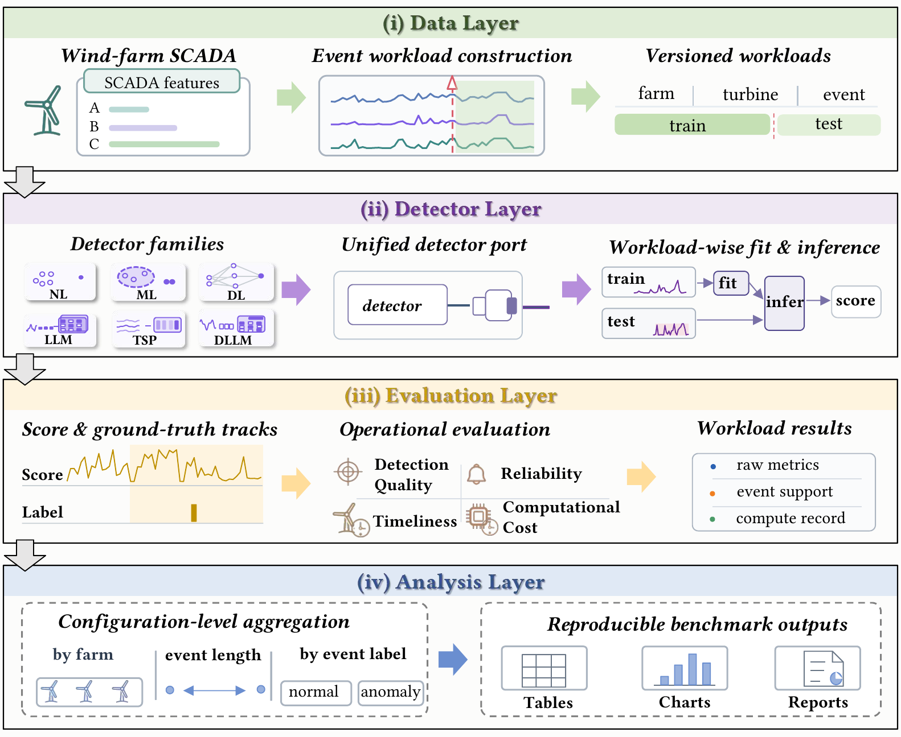

<h1 align="center">WindADBench</h1>

<p align="center">
  <strong>A Benchmark for Time-Series Anomaly Detection in Wind Turbine Operations</strong>
</p>

<p align="center">
  <a href="https://zju-daily.github.io/WindADBench/">https://zju-daily.github.io/WindADBench/</a>
</p>

<p align="center">
  <a href="#overview">Overview</a> ·
  <a href="#data">Data</a> ·
  <a href="#quick-start">Quick Start</a> ·
  <a href="#experiments">Experiments</a> ·
  <a href="#decision-agent">Decision Agent</a>
</p>

<p align="center">
  
</p>

---

<a id="overview"></a>

## ✨ Overview

WindADBench evaluates wind-turbine SCADA anomaly detectors as complete
**alarm systems**. We compare 36 detectors from six model families across four
tracks, examining not only detection quality but also warning earliness,
reliability, and cost.

### Benchmark at a Glance

| | Farm A | Farm B | Farm C | Total |
|---|---:|---:|---:|---:|
| Location | Portugal | Germany | Germany | — |
| Setting | Onshore | Offshore | Offshore | — |
| Turbines | 5 | 9 | 22 | 36 |
| Sensors / features | 54 / 86 | 63 / 257 | 238 / 957 | — |
| Records (×10³) | 1,197 | 859 | 3,187 | 5,243 |
| Feature values (×10⁶) | 103 | 221 | 3,050 | 3,374 |
| Test turbine-days | 351 | 501 | 1,101 | 1,953 |

The dataset provides 10-minute SCADA measurements spanning approximately
89 turbine-years.

### Evaluation Tracks

| Track | Setting | Evaluation target |
|---|---|---|
| **Track 1** | In-farm | Disjoint training and evaluation periods from the same turbine |
| **Track 2** | Normal operation | False-alarm stability on normal sequences |
| **Track 3** | Cross-turbine | Fixed held-out turbines within each farm |
| **Track 4** | Cross-farm | Six directed transfers among Farms A, B, and C |

---

<a id="data"></a>

## 📊 Data

Download the [CARE v6 dataset](https://doi.org/10.5281/zenodo.15846963) and place it
in the repository root:

```text
WindADBench/
├── Wind Farm A/
│   ├── datasets/*.csv
│   ├── event_info.csv
│   └── feature_description.csv
├── Wind Farm B/
│   ├── datasets/*.csv
│   ├── event_info.csv
│   └── feature_description.csv
└── Wind Farm C/
    ├── datasets/*.csv
    ├── event_info.csv
    └── feature_description.csv
```

---

<a id="quick-start"></a>

## 🚀 Quick Start

```bash
git clone https://github.com/ZJU-DAILY/WindADBench.git
cd WindADBench
conda env create -f environment.yml
conda activate wind_benchmark
```

For models requiring pretrained weights, see [models/README.md](models/README.md).

---

<a id="experiments"></a>

## 🧪 Experiments

### In-farm

```bash
bash scripts/baselines/non_learning/score/lof.sh
```

### Normal background

```bash
python experiments/normal_background/run.py --results results/non_learning/score/lof.csv --dataset-root . --output outputs/normal_background
```

### Build the cross-domain dataset

```bash
python experiments/cross_domain/build_core3_dataset.py --source-root . --output-root derived_datasets/core3_v1_care_v6
```

### Cross-turbine

```bash
bash experiments/cross_domain/scripts/baselines/non_learning/lof.sh A
bash experiments/cross_domain/scripts/baselines/non_learning/lof.sh B
bash experiments/cross_domain/scripts/baselines/non_learning/lof.sh C
```

### Cross-farm

```bash
bash experiments/cross_domain/scripts/run_full_fleet.sh non_learning/lof --foreground
```

### All cross-turbine models

```bash
REUSE_SOURCE=0 bash experiments/cross_domain/scripts/run_all.sh
```

<a id="decision-agent"></a>

## Decision Agent

```bash
python -I agent/run.py
python -I agent/verify.py
```

